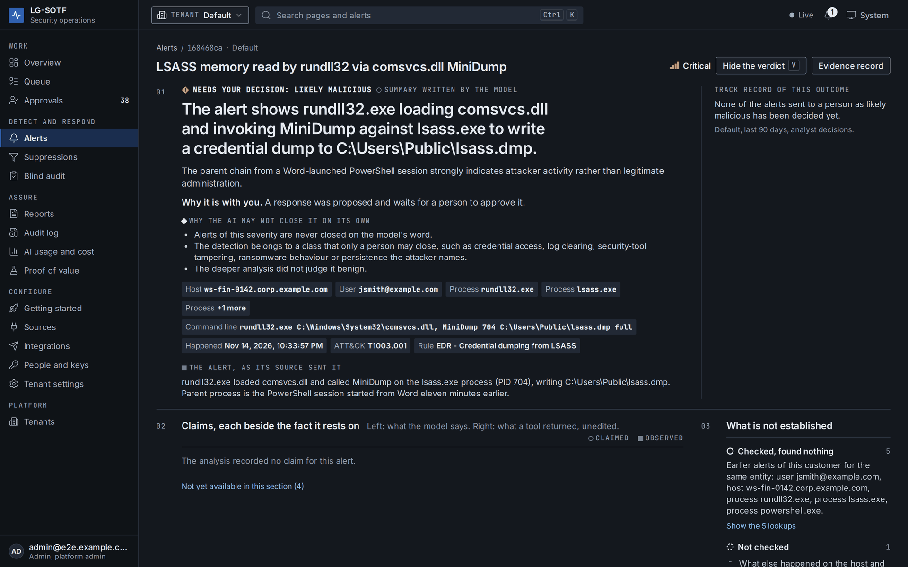
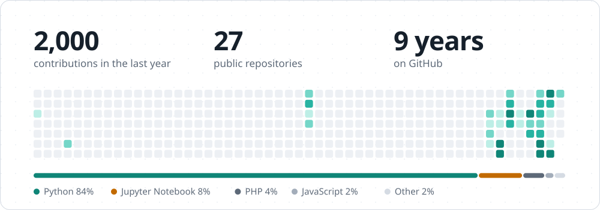

<picture>
  <source media="(prefers-color-scheme: dark)" srcset="assets/hero-dark.svg">
  
</picture>

I'm Ahmed. I build **[LG-SOTF](https://github.com/gapilongo/SOC)**, a self-hosted AI SOC. It investigates security alerts, closes the false alarms, and hands the real ones to an analyst with the evidence beside every claim. It runs on your own infrastructure, on a local or EU-hosted model, and every response action waits for a person's approval.

## Building now

**[LG-SOTF](https://github.com/gapilongo/SOC)** · Python · FastAPI · PostgreSQL · LangGraph · React  
Self-hosted, multi-tenant AI SOC for MSSPs: AI triage and investigation, human-approved response, audit-grade evidence, signed releases.

## Also here

- **[pentest-copilot](https://github.com/gapilongo/pentest-copilot)**: a self-hosted pentest copilot built on a technique catalog, playbooks, retrieval and deterministic tools, with verifier rules and an LLM-as-judge quality evaluation.
- **[AegisGraph](https://github.com/gapilongo/AegisGraph)**: an earlier LangGraph framework for SOC alert triage and orchestration.
- **[Stock-Market-Analyzer](https://github.com/gapilongo/Stock-Market-Analyzer)**: a Streamlit app for technical analysis, with live prices, moving averages, RSI and interactive charts.

## Activity

<picture>
  <source media="(prefers-color-scheme: dark)" srcset="assets/activity-dark.svg">
  
</picture>

## Reach me

[nibniw@gmail.com](mailto:nibniw@gmail.com)
